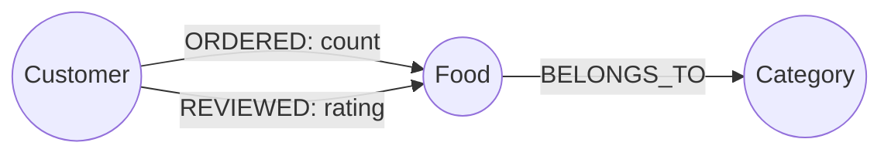
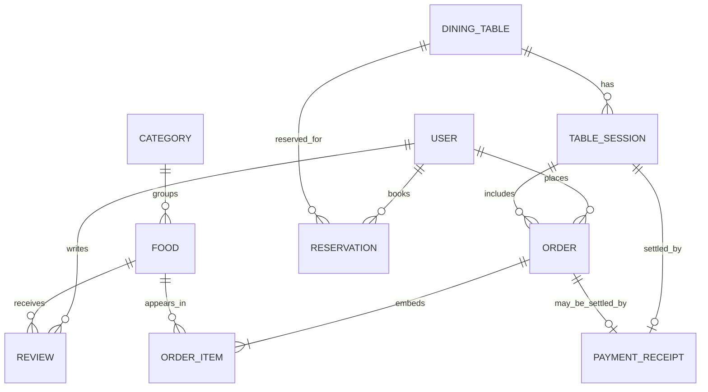

# Database Model — MongoDB, Redis, Neo4j
**Phiên bản:** 1.0 · **Ứng dụng:** Website quản lý đặt món tại quán ăn  
**Hướng đồ án:** Chỉ dùng NoSQL để lưu nghiệp vụ chính; SQL Server KLCN không nằm trong kiến trúc của repo này.

## 1. Thực thể, mô hình và nơi lưu

| STT | Loại dữ liệu | Hệ lưu trữ | Cấu trúc | Lý do |
|---|---|---|---|---|
| 1 | Danh mục, món, tài khoản, đánh giá, tồn kho | MongoDB | Document / collection | Dữ liệu nghiệp vụ có cấu trúc linh hoạt |
| 2 | Đơn hàng, phiếu thu, lịch đặt và lịch sử trạng thái | MongoDB | Document + nested subdocuments + timestamp | Cần lưu bền và tra cứu theo ngày |
| 3 | Giỏ hàng, cache, locks, blocklist | Redis | Hash, String, TTL | Nhanh và có thời gian hết hạn |
| 4 | Bảng xếp hạng món bán chạy | Redis | Sorted Set | Truy vấn thứ hạng nhanh |
| 5 | Quan hệ khách–món–danh mục | Neo4j | Node, relationship | Truy vấn cộng tác và kết nối nhiều bước |

Giảng viên yêu cầu **ít nhất bốn loại dữ liệu**, không đồng nghĩa chỉ có ba loại hệ quản trị: ví dụ ở bảng trên minh họa dữ liệu cấu trúc, dữ liệu giao dịch/lịch sử thời gian, key-value/TTL, xếp hạng và graph. Cần giảng viên xác nhận nếu yêu cầu “loại dữ liệu” được hiểu khác.

## 2. MongoDB — Database `restaurant_nosql` (port 27017)

Mongoose tự sử dụng tên collection dạng số nhiều, chữ thường. Có 12 model tương ứng `backend/src/models`:

| Collection | Model | Trường trọng tâm / ví dụ | Quan hệ logic |
|---|---|---|---|
| `users` | User | fullName, email, passwordHash, phone, role, loyaltyPoints | Một user có nhiều order/review |
| `categories` | Category | name, slug, type, description | Một category có nhiều food |
| `foods` | Food | name, slug, price, category, imageUrl, tags, isAvailable, soldCount | Thuộc Category |
| `orders` | Order | orderCode, customer?, tableSession?, items[], subtotal, totalAmount, status, paymentStatus | Order nhúng item snapshot, tham chiếu session |
| `reviews` | Review | customer, food, order, rating, comment | Khách đánh giá món đã dùng |
| `diningtables` | DiningTable | name, area, capacity, status | Một bàn có các phiên theo thời gian |
| `tablesessions` | TableSession | table, tableNumber, guestCount, status, paymentState, activity[] | Giữ nhiều lượt Order |
| `reservations` | Reservation | customer, reservedAt, guestCount, table, statusHistory[] | Khách đặt trước bàn |
| `paymentreceipts` | PaymentReceipt | receiptCode, scopeType, scopeId, orders[], method, amount, confirmedBy | Một hóa đơn/phiên có biên nhận |
| `promotions` | Promotion | code, discountType, discountValue, startAt, endAt | Áp dụng giảm giá |
| `inventoryitems` | InventoryItem | name, unit, currentStock, minimumStock, movements[] | Nhập/xuất và cảnh báo |
| `notifications` | Notification | user, type, title, message, isRead, link | Hộp thư thông báo |

Ví dụ thiết kế `orders` (dữ liệu minh họa, ID không phải dữ liệu thật):

```json
{
  "orderCode": "OD-DEMO-001",
  "source": "staff",
  "orderType": "dine-in",
  "tableNumber": "T1-A1",
  "status": "confirmed",
  "items": [
    { "food": "ObjectId(...)", "name": "Lẩu bò", "price": 220000, "quantity": 1, "note": "Ít cay" }
  ],
  "subtotal": 220000,
  "totalAmount": 220000,
  "paymentStatus": "pending",
  "statusHistory": [{ "status": "confirmed", "changedAt": "2026-11-21T03:00:00Z" }]
}
```

Ví dụ `TableSession.activity` là loại dữ liệu sự kiện theo thời gian:
```json
{
  "tableNumber": "T1-A1",
  "guestCount": 3,
  "status": "active",
  "activity": [
    { "action": "open", "detail": "Nhận bàn thường", "at": "2026-11-21T03:00:00Z" },
    { "action": "order", "detail": "OD-DEMO-001", "at": "2026-11-21T03:04:00Z" }
  ]
}
```

### 2.1 Index/ràng buộc tiêu biểu

- `users.email` unique, `categories.slug` unique, `foods.slug` unique.
- `foods` có text index trên tên/mô tả/tags; index theo category/isAvailable.
- `orders.orderCode` unique; `orders(tableSession,clientRequestId)` unique khi clientRequestId là string.
- `tablesessions.table` unique **chỉ khi status=active**, ngăn hai nhân viên mở hai phiên cùng bàn.
- `paymentreceipts(scopeType,scopeId)` unique, `bankTransactionRef` unique nếu có mã giao dịch.
- `reviews(customer,food,order)` unique.
- Lược đồ chính xác, giá trị default và validation nằm trong mã của từng file `backend/src/models/*.js`. Bảng tài liệu là sơ đồ tóm tắt, không thay thế schema thực thi.

### 2.2 CRUD và lọc/tìm/đếm

- **Create:** `POST /api/admin/foods`, `POST /api/orders`, `POST /api/reviews`.
- **Read/Search:** `GET /api/foods?search=...&category=...&sort=popular`, `GET /api/orders/mine`.
- **Update:** `PUT /api/admin/foods/:id`, `PATCH /api/orders/:id/status`.
- **Delete/soft delete:** `DELETE /api/admin/foods/:id` thực tế đánh dấu `isAvailable=false`; xóa category chỉ nếu không có món.
- **Aggregate:** thống kê đơn và doanh thu bằng `Order.aggregate` và `Review.aggregate`; tổng collection trong trang CSDL NoSQL.

## 3. Redis — port 6379

| Key pattern | Kiểu | TTL | Nghiệp vụ và lệnh kiểm tra |
|---|---|---|---|
| `cart:user:<id>` | Hash | 24h | `HGETALL`, `TTL` |
| `cart:guest:<id>` | Hash | 24h | Giỏ chưa đăng nhập |
| `menu:categories` | String(JSON) | 300s | `GET`, `TTL`; miss đọc MongoDB |
| `leaderboard:foods` | Sorted Set | Không | `ZREVRANGE` |
| `table:lock:<sessionId>` | String | 300s | `GET`, `TTL`; NX khi nhận |
| `payment:confirm:<scope>:<id>` | String | 30s | Chống thu trùng trong thời gian xử lý |
| `token:block:<jti>` | String | TTL còn lại JWT | Chặn JWT đã logout |

Không dùng `FLUSHDB` hoặc `KEYS *` trong máy có dữ liệu thật. Redis mất key cache/lock do TTL là dự kiến. Việc phục hồi key cần dựa vào MongoDB khi nghiệp vụ cho phép.

## 4. Neo4j — Bolt port 7687 / Browser port 7474



| Node | Thuộc tính | Ràng buộc |
|---|---|---|
| `Customer` | id, name | Unique id |
| `Food` | id, name, price | Unique id |
| `Category` | id, name | Unique id |

Ba loại quan hệ hiện được ghi thật trong `backend/src/services/graph.js`. Script kiểm tra, tạo demo và truy vấn nằm trong `database/neo4j`. Lưu ý: các quan hệ `LIKES` và `ORDERED_WITH` xuất hiện trong **bản thiết kế sơ bộ**, nhưng **chưa có trong Graph Service thực tế**; do đó không liệt kê là đã triển khai.

### 4.1 Truy vấn gợi ý

Tìm món từ nhóm khách có lịch sử đặt/đánh giá trùng:
```cypher
MATCH (me:Customer {id: $userId})-[:ORDERED|REVIEWED]->(liked:Food)
MATCH (other:Customer)-[:ORDERED|REVIEWED]->(liked)
WHERE other <> me
MATCH (other)-[:ORDERED|REVIEWED]->(candidate:Food)
WHERE NOT (me)-[:ORDERED|REVIEWED]->(candidate)
RETURN candidate.id AS id, count(DISTINCT other) AS score
ORDER BY score DESC LIMIT 8;
```
Nếu gợi ý Neo4j không có kết quả, hệ thống trả món phổ biến lấy qua Redis rồi MongoDB.

## 5. Quan hệ logic toàn hệ thống



Đây là **ERD logic**, không phải các bảng quan hệ SQL. Các quan hệ trong MongoDB là ObjectId, nhúng subdocument và query từ ứng dụng.

## 6. Nguồn dữ liệu mẫu, kiểm tra và an toàn

- Catalog KLCN: `backend/src/data/menuCatalog.js` (37 món / 7 danh mục). Ảnh: `backend/public/images/menu`.
- Bộ dữ liệu khởi tạo `backend/src/data/seed.js`: chỉ chạy trong cơ sở dữ liệu demo vì **xóa** dữ liệu hiện tại của các collection, Redis và Neo4j.
- Phục hồi chỉ bổ sung món thiếu: `npm run restore:menu`; không xóa tài khoản/đơn/phiếu thu.
- Bản minh họa JSON và script cho từng hệ: `database/mongodb/`, `database/redis/`, `database/neo4j/`.
- Chạy lệnh kiểm tra **chỉ đọc** `npm run verify:databases` khi cả ba container đã sẵn sàng.
