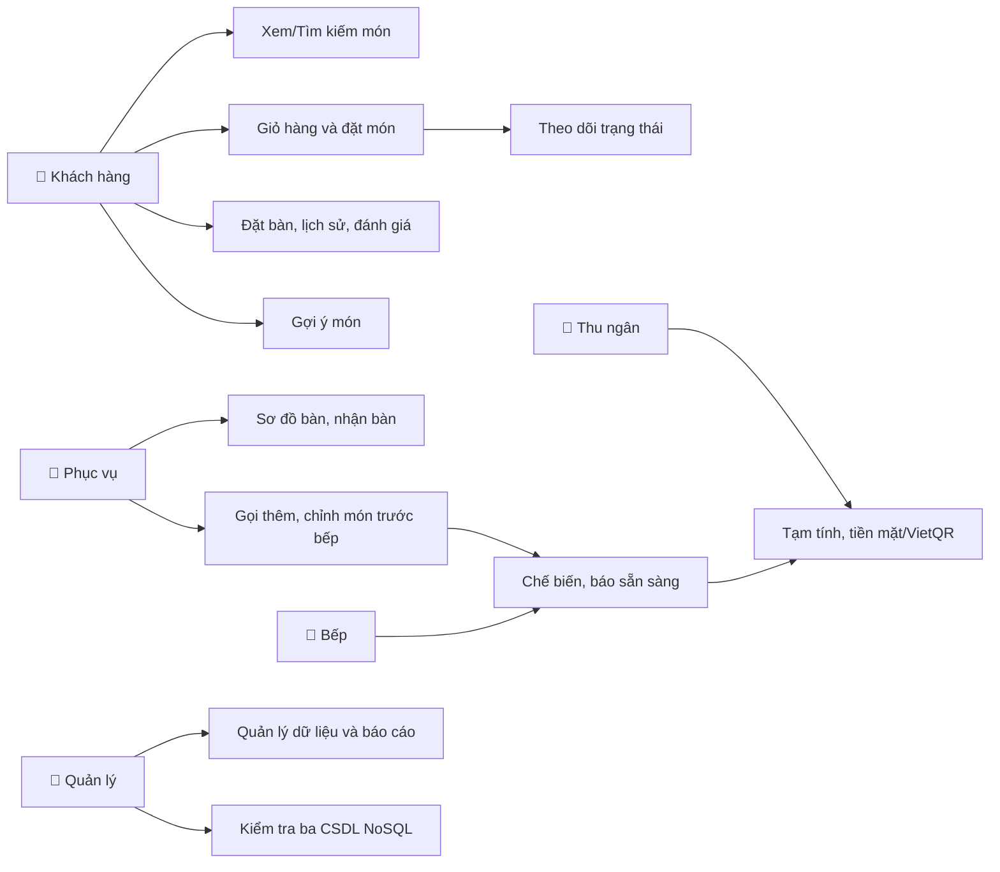
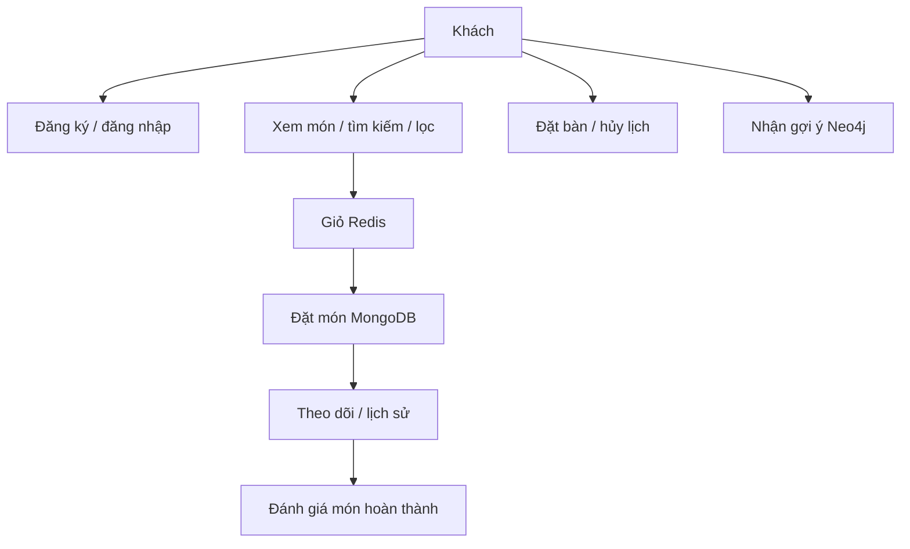
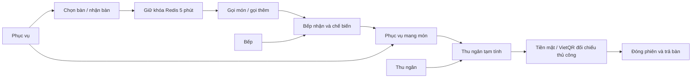
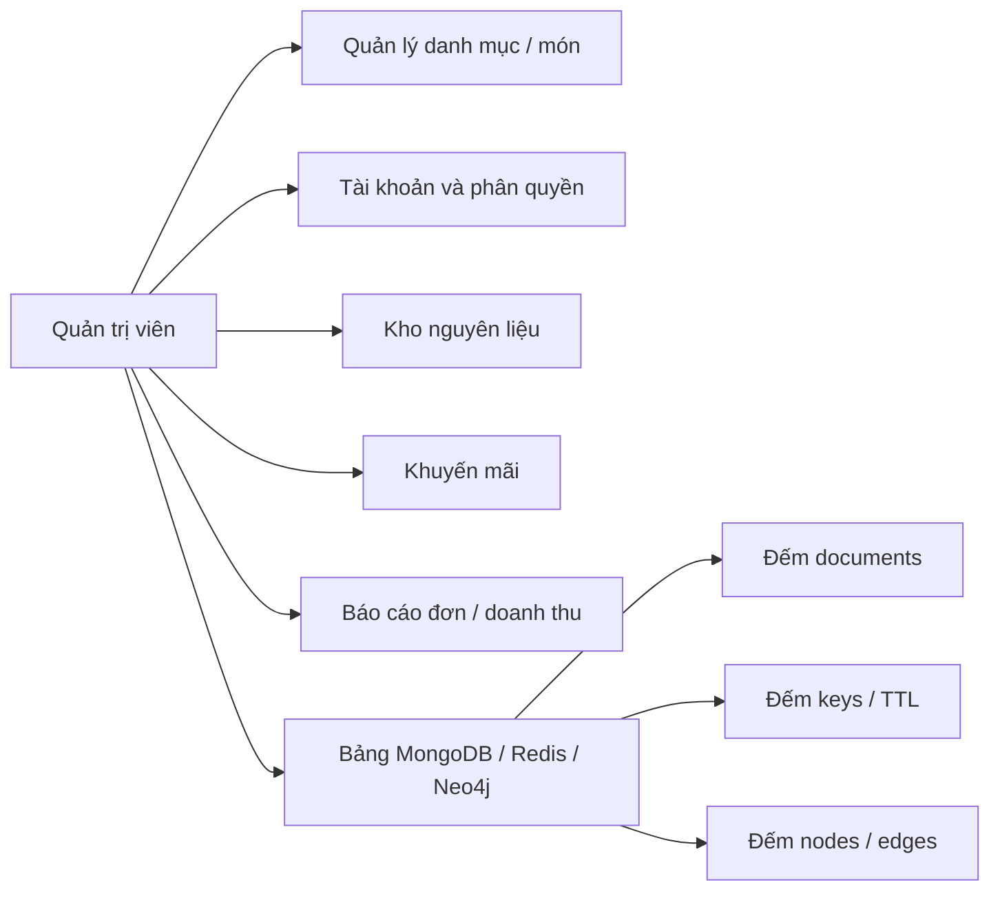
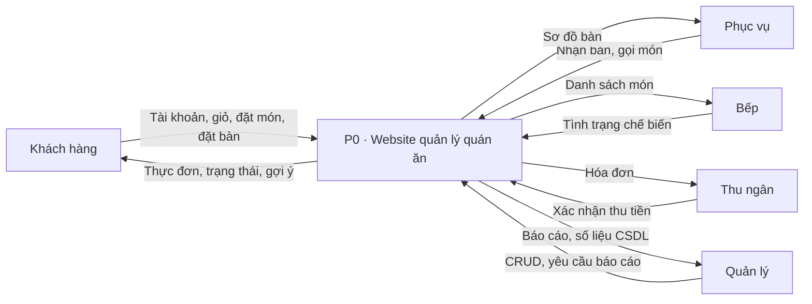
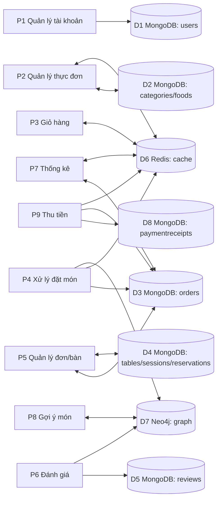
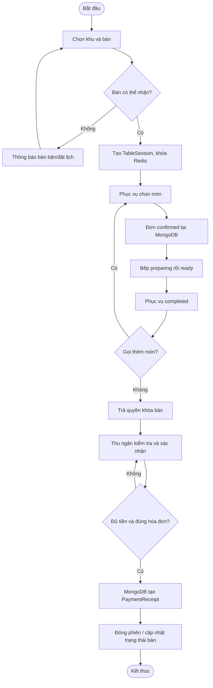
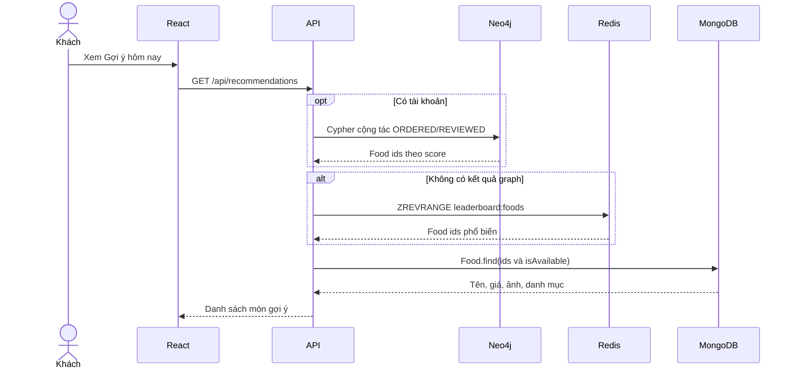

# Sơ đồ hệ thống — Use Case, DFD, Activity, Sequence, ERD
Các sơ đồ Mermaid dưới đây phản ánh hệ thống ba NoSQL **đang có trong mã nguồn**. Bản phân tích sơ bộ cũ chỉ có Khách và Quản trị; bản này cập nhật thêm Phục vụ/Bếp/Thu ngân.

## 1. Use Case tổng quát (dạng sơ đồ tác nhân–chức năng)

## 2. Use Case hệ thống Khách hàng

## 3. Use Case hệ thống Nhân viên và thu ngân

## 4. Use Case hệ thống Quản trị viên

## 5. DFD cấp 0 — Sơ đồ ngữ cảnh

## 6. DFD cấp 1 — Phân rã 8 tiến trình gốc, bổ sung nghiệp vụ bàn/thu tiền

**Lưu ý:** Đây là DFD logic đã mở rộng từ tám tiến trình trong tài liệu sơ bộ lên thêm P9 thu tiền; không phải biểu đồ mô tả chi tiết từng lời gọi API.

## 7. Activity — Từ nhận bàn đến thanh toán

## 8. Sequence — Gợi ý cá nhân hóa

## 9. ERD logic và graph

Xem [DATABASE_MODEL.md](DATABASE_MODEL.md) để có sơ đồ ERD logic, node, edge và các index cụ thể. Có thể xuất hình từ Mermaid khi đưa vào Word/PDF; không dùng sơ đồ này thay thế code hoặc dữ liệu thực.
