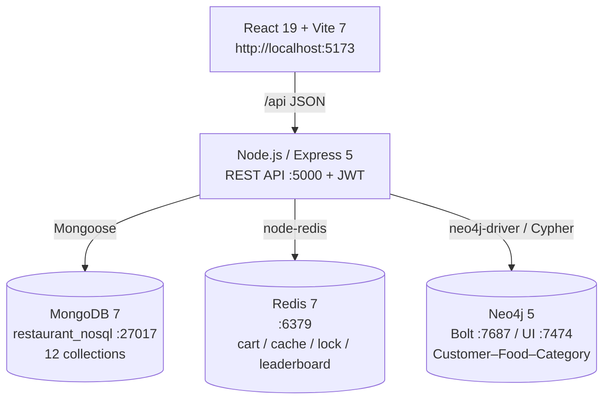
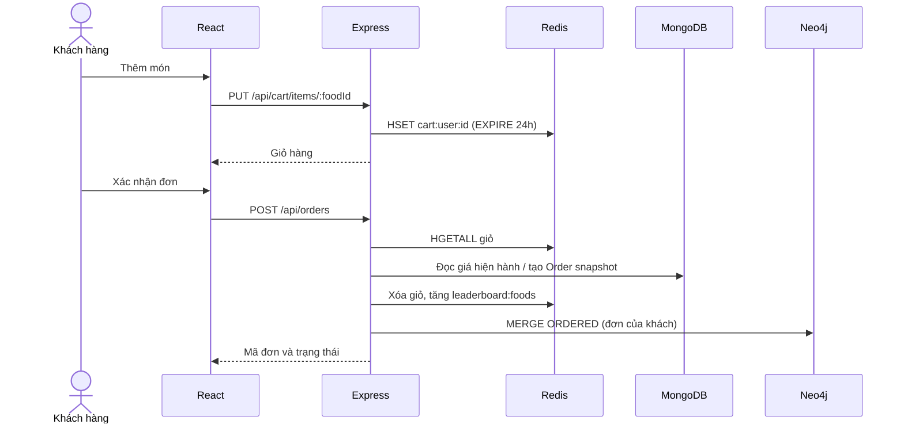
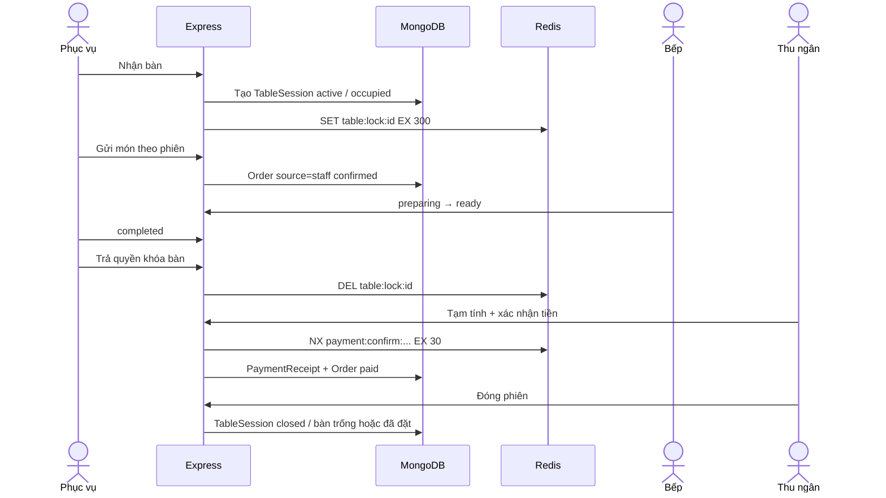

# SDS — Đặc tả thiết kế phần mềm
**Đề tài:** Website quản lý đặt món tại quán ăn với MongoDB, Redis và Neo4j  
**Phiên bản:** 1.0 · **Nguồn:** mã nguồn GitHub và [SRS](SRS.md), không áp dụng hệ thống SQL Server KLCN.

## 1. Thiết kế kiến trúc

Các container được khai báo tại `docker-compose.yml`. Backend `backend/src/config/database.js` tạo ba kết nối từ `backend/src/config/env.js`. Frontend gửi REST qua proxy Vite (`frontend/vite.config.js`).

## 2. Bố cục module và trách nhiệm

| Đường dẫn | Thiết kế / dữ liệu |
|---|---|
| `frontend/src/pages/MenuPage.jsx` | Hiển thị/tìm món |
| `frontend/src/pages/CartPage.jsx` | Giỏ/checkout |
| `frontend/src/pages/OrdersPage.jsx` | Lịch sử đơn và QR của khách |
| `frontend/src/pages/StaffTablesPage.jsx` | Sơ đồ bàn, phiên, order và thu tiền |
| `frontend/src/pages/KitchenPage.jsx` | Hàng đợi bếp |
| `frontend/src/pages/OperationsPage.jsx` | Vận hành, báo cáo và tab CSDL NoSQL |
| `backend/src/app.js` | Khai báo các nhóm API |
| `backend/src/routes/auth.js` | JWT, bcrypt, đăng xuất Redis |
| `backend/src/routes/catalog.js` | MongoDB + cache Redis |
| `backend/src/routes/cart.js` / `services/cart.js` | Giỏ hàng Redis |
| `backend/src/routes/orders.js` | Đơn khách, cập nhật đơn, đồng bộ graph |
| `backend/src/routes/staff.js` | TableSession, Redis lock, order theo lượt |
| `backend/src/routes/payments.js` | Phiếu thu tiền mặt/chuyển khoản |
| `backend/src/routes/nosql.js` | API đọc số liệu ba DB cho quản lý |
| `backend/src/services/graph.js` | Tạo node, quan hệ, chạy gợi ý Neo4j |
| `backend/src/services/cache.js` | JSON cache danh mục + TTL |
| `backend/src/data/seed.js` | **Reset dữ liệu mẫu**: chỉ dùng môi trường demo riêng |
| `backend/src/data/restore-menu.js` | Bổ sung món KLCN không xóa đơn hàng |

## 3. Luồng dữ liệu

## 4. Thiết kế MongoDB

- Nguồn sự thật: MongoDB `restaurant_nosql`, data dạng document JSON/BSON.
- Ví dụ `orders.items` nhúng `food`, `name`, `price`, `quantity`, `note`; giá snapshot không bị đổi theo thực đơn.
- Quan hệ `User → Order`, `Category → Food`, `DiningTable → TableSession → Order`, `PaymentReceipt → Order` lưu bằng ObjectId ref; không có foreign key SQL.
- Index:
  - `users.email` unique; `foods.name/description/tags` text search;
  - `orders.orderCode` unique; `orders(customer,createdAt)`; `orders(tableSession,clientRequestId)` unique có điều kiện;
  - `tablesessions.table` unique với `status=active`;
  - `paymentreceipts(scopeType,scopeId)` unique và `bankTransactionRef` unique có điều kiện;
  - `reviews(customer,food,order)` unique.
- Chi tiết collection/mẫu JSON: [DATABASE_MODEL.md](DATABASE_MODEL.md).

## 5. Thiết kế Redis

- `cart:user:<id>` và `cart:guest:<id>`: Hash, TTL 86.400 giây, key là foodId và value JSON.
- `menu:categories`: String JSON, TTL 300 giây; miss → đọc MongoDB.
- `leaderboard:foods`: Sorted Set (ZINCRBY), không TTL.
- `token:block:<jti>`: String, TTL còn lại của JWT.
- `table:lock:<sessionId>`: String userId, TTL 300 giây, thao tác NX/gia hạn/trả.
- `payment:confirm:<scope>:<id>`: String owner, NX EX 30 chống hai người xác nhận đồng thời.

Các key là dữ liệu tạm và chỉ số hỗ trợ; không dùng Redis làm sổ cái thanh toán. **Không chạy FLUSHDB trên DB đang dùng**.

## 6. Thiết kế Neo4j

**Node:** Customer {id,name}, Food {id,name,price}, Category {id,name}.  
**Edge:** Customer -ORDERED-> Food {count,lastOrderedAt}, Customer -REVIEWED-> Food {rating,updatedAt}, Food -BELONGS_TO-> Category.  
Tạo unique constraint trên `id` của ba node. Backend lấy các ID gợi ý từ Neo4j sau đó tra MongoDB để lấy tên/giá/hình ảnh còn phục vụ; không coi graph là bảng lưu món chính. Các quan hệ ORDERED/REVIEWED tạo từ luồng khách và dữ liệu demo; luồng phục vụ không tự gắn đồ thị vào một customer nếu không có định danh khách. Chi tiết: [database/neo4j](../database/neo4j).

## 7. API và ràng buộc

| API | Vai trò | Tác động |
|---|---|---|
| `POST /api/auth/login` | Công khai | JWT, Redis merge giỏ |
| `GET /api/foods`, `GET /api/categories` | Công khai | MongoDB + Redis |
| `GET /api/recommendations` | Công khai/khách | Neo4j + Redis + MongoDB |
| `PUT /api/cart/items/:foodId` | Khách/guest | Redis |
| `POST /api/orders` | Đăng nhập | MongoDB + Redis + Neo4j |
| `GET /api/staff/tables` | Staff/cashier/admin | MongoDB |
| `POST /api/staff/tables/:id/open` | Staff/admin | MongoDB + Redis |
| `POST /api/staff/sessions/:id/orders` | Staff/admin | MongoDB + Redis |
| `POST /api/payments/session/:id/confirm` | Cashier/admin | MongoDB + Redis |
| `GET /api/nosql/overview` | **Admin** | Chỉ đọc tổng hợp cả ba DB |

Backend dùng Zod xác thực input, Mongoose schema xác thực dữ liệu document, Express middleware phân quyền. HTTP 400 (sai), 401 (chưa đăng nhập), 403 (không có quyền), 409 (xung đột), 423 (bị khóa).

## 8. Nhất quán và ngoại lệ

- MongoDB là nguồn sự thật cho đơn/phiếu thu. Redis có TTL và hoạt động khóa tạm. Neo4j là bản đồ quan hệ dẫn xuất.
- Không có distributed transaction giữa MongoDB–Redis–Neo4j. Trong thực tế vẫn có nguy cơ MongoDB ghi thành công nhưng graph/cache đồng bộ không thành công; kiến nghị outbox/retry và hệ thống giám sát.
- Một phiên bàn active được bảo vệ bằng unique partial index MongoDB; khóa Redis giảm khả năng ghi đè.
- Phiếu thu có unique index chống trùng, nhưng **chưa** phải cơ chế xử lý giao dịch thanh toán của hệ thống ngân hàng thật.
- `GET /api/nosql/overview` là read-only và chỉ cho admin xem số lượng; tuyệt đối không trả mật khẩu, hash, thông tin giao dịch chi tiết.
- Chưa có backup/restore tự động, đo tải lớn hay tự kiểm chứng số tiền chuyển khoản.

## 9. Thiết kế giao diện và triển khai

- Vai trò: `customer` → `/`; `staff`/`cashier` → `/staff/tables`; `kitchen` → `/kitchen`; `admin` → `/operations`.
- Quản lý → **CSDL NoSQL** xem số document/key/node/edge trực tiếp.
- Triển khai local: Docker Compose ba container; frontend port 5173, backend 5000; ảnh món được phục vụ tại `/images`.
- Scripts demo/kiểm tra chạy ở DB demo; xem [NO_SQL_RUNBOOK.md](NO_SQL_RUNBOOK.md).

**Phân biệt:** Đây là bản thiết kế phản ánh code hiện tại, không khẳng định tính năng đang ở mục “Chưa có” của SRS là đã triển khai.
